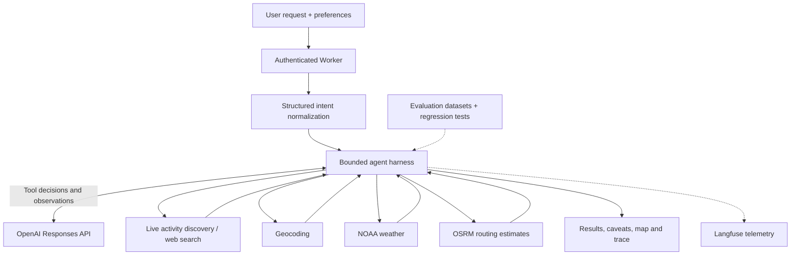

# Adventure Planner

**An agentic AI outdoor adventure planner for California.**

Discover where to go, when to go and how to combine outdoor activities without manually researching dozens of destinations, forecasts and travel routes.

A hands-on product management case study by Marine Cabaud, exploring the end-to-end lifecycle of an agentic AI product: discovery, UX, product requirements, orchestration, integrations, evaluations and observability.

[Product requirements](PRD.md) · [Architecture](docs/architecture.md) · [Evaluation framework](evals/README.md) · [Development history](CHANGELOG.md)

## Product experience

Try prompts such as:

- “Where in California can I kitesurf in spring?”
- “I want to run at Sea Ranch next week.”
- “I want to ski and trail run around Tahoe, with less than 60 minutes driving between activities.”

The UX combines a natural-language entry point, optional structured preferences, recommendation cards, map and an expandable execution trace. It covers skiing/snowboarding, kitesurfing, hiking, mountain biking, surfing, trail running and cycling.

**Status:** working experimental MVP, not a production trip advisor. The hosted live prototype is access-controlled; this repository documents the implementation. Recommendations are exploratory and may lack sufficient evidence to satisfy all constraints.

## What makes it agentic?

The model is responsible for deciding what information it needs, selecting registered tools and synthesizing evidence. A separate, model-independent harness controls execution, budgets, input validation, provenance and the final result. When a mandatory constraint cannot be supported, the agent can return an insufficient-evidence outcome rather than inventing a recommendation.



See [architecture and implementation trade-offs](docs/architecture.md) for the CLI/MCP path, tool boundaries and limitations.

## Evaluation: from failure to iteration

The MVP was developed with failure-driven evaluation. Instead of treating a successful model call as product success, the framework checks intent extraction, tool use, constraints, sources and recommendation quality separately.

| Baseline (November 26, 2026) | Recorded result | How to interpret it |
| --- | --- | --- |
| [Intent and context](evals/baseline-v1.md) | 99/129 behavioral criteria demonstrated (76.7%) | Historical judge baseline; some false positives and unobserved structured checks |
| [Tool selection](evals/tool-selection-baseline-v1.md) | 91/103 checks (88.3%) | Deterministic historical fixture-era baseline; does not measure live discovery |
| [Recommendation quality](evals/recommendation-quality-baseline-v1.md) | 102/102 technical checks; 86.4% weighted quality, 97.8% evidence coverage | Ten scenarios; provisional web-research LLM judge, partial credit, one unknown; workflow failed by design on unknown |

These are historical results for the linked source commits, not scores for the current build. Subsequent live discovery and geocoding runs have mixed outcomes, including failures; the agent is not fully quality-validated.

**Product learnings:** failures revealed redundant clarification, incomplete geographic inventory, unverified activity access, missing skill evidence and hard transfer constraints. Later iterations added normalized intent, live search, geocoding, and stricter transfer-limit handling. The next priority is re-evaluation after those changes.

## Repository map

| Path | Purpose |
| --- | --- |
| [PRD.md](PRD.md) | Product problem, requirements, scope, metrics and status |
| [dist/](dist/) | Browser UI, intent logic, model-independent harness and illustrative fixtures (checked-in source despite the folder name) |
| [models/](models/) | OpenAI Responses API adapter |
| [integrations/](integrations/) | Discovery, geocoding, weather, routing, MCP and telemetry |
| [worker/](worker/) | Authenticated hosted API and asset serving |
| [evals/](evals/) | Datasets, scorers, baseline reports and live evaluation runners |
| [tests/](tests/) | Automated regression and failure-path tests |
| [AGENTS.md](AGENTS.md) | Development instructions and guardrails |
| [CHANGELOG.md](CHANGELOG.md) | Development milestones and historical notes |

## Run locally

Requires Node.js 24+ and npm. Mocked tests do not require API credentials.

```sh
npm ci
npm test
node --test evals/*.test.mjs
```

To try the CLI with the live model, copy `.env.example` to `.env`, provide your own OpenAI API key securely and run:

```sh
npm run agent:live -- "Ski and trail running in Tahoe; compare north shore and Sierra foothills" '{"maxTransferMinutes":60}'
```

The CLI uses the original illustrative candidate inventory plus the weather MCP and routing tools, not the hosted worker's web discovery path. Live calls require network access and may incur API charges.

Other commands:

- `npm run weather:mcp -- YYYY-MM-DD YYYY-MM-DD` — dates within the available forecast horizon, using NOAA through MCP.
- `npm run routing:demo -- 60` — representative area driving estimate.
- `node scripts/build-worker.mjs` — generate the hosted deployment bundle (not a standalone local server).

Never commit API keys. The hosted UI requires authenticated access and server-side runtime variables; publishing source code does not grant access to the hosted app.

## Limitations and next steps

- Re-run intent, discovery, recommendation and map acceptance tests against the current source and deployed version.
- Verify exact activity coordinates, access, skill suitability, resort opening and sport-specific conditions using authoritative sources.
- Use a production-appropriate routing provider and verify actual activity-to-activity travel constraints. OSRM's public demo estimates are not live traffic or road safety guidance.
- Improve ranking and multi-turn context; no persistent conversation memory or booking is implemented.
- Human-calibrate the quality rubric; track latency, cost, task success and evidence coverage over time.
- Before opening a public live demo, implement usage quotas, abuse controls and cost monitoring.

Outdoor conditions change. Check official local sources before relying on any recommendation.
