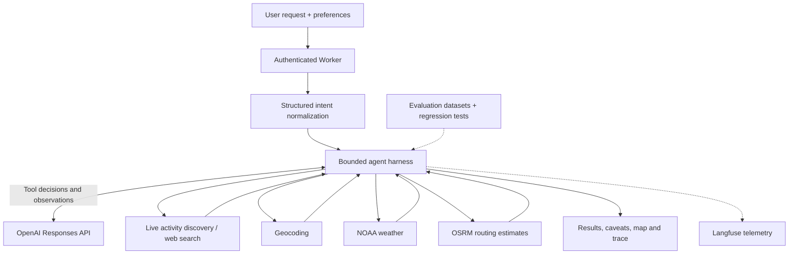

# Adventure Planner

**An agentic AI outdoor adventure planner for California.**

Discover where to go, when to go and how to combine outdoor activities by researching destinations, weather and travel constraints through a single conversational experience.

A hands-on AI Product Management case study by Marine Cabaud, covering product discovery, UX, agent orchestration, tool integration, evaluation and observability.

[Get started](#get-started) · [Code walkthrough](docs/code-tour.md) · [Architecture](docs/architecture.md) · [Product requirements](PRD.md) · [Evaluations](evals/README.md)

## Features

- **Natural-language planning:** specify sports, destination, dates, skill level and travel constraints; use optional structured preferences.
- **Multi-sport discovery:** seven sports across California, including ski/snowboard, kitesurf, surf, hiking, mountain biking, trail running and cycling.
- **Live research and map:** source-backed exploratory candidates, geocoding and recommendation cards.
- **Weather and logistics:** short-range NOAA forecasts and OSRM driving estimates where evidence permits.
- **Agent guardrails:** validate tool calls and provenance, enforce execution budgets, surface uncertainty and avoid silently relaxing mandatory constraints.
- **Quality and observability:** regression tests, evaluation datasets, historical baselines and Langfuse traces.

**Status:** experimental MVP. The hosted prototype is access-controlled, while the source and local examples are public. Recommendations are exploratory, not verified travel itineraries.

## Get started

### 1. Clone and install

Requires [Node.js](https://nodejs.org/) 24+ and npm.

```bash
git clone https://github.com/marinecabaud/adventure-planner.git
cd adventure-planner
npm ci
```

### 2. Try the offline demo — no API key required

```bash
node examples/quickstart.mjs
```

Try another supported scenario:

```bash
node examples/quickstart.mjs "Where in California can I kitesurf in spring?"
```

This runs the real harness with a deterministic stand-in model and illustrative fixtures. It prints a JSON result with status, candidate cards, trace and tool-call metrics. No live search, LLM, weather or routing requests occur. The offline demo does not verify real-world suitability or hard constraints.

### 3. Run automated checks — no API key required

```bash
npm test
node --test evals/*.test.mjs
```

### 4. Try the live CLI (optional)

Copy the environment example:

```bash
cp .env.example .env
```

Set your own `OPENAI_API_KEY` in the local `.env` file. Optionally configure `OPENAI_MODEL` (the default is defined in the model adapter). Keep credentials private and outside Git.

```bash
npm run agent:live -- "Ski and trail running in Tahoe; compare north shore and Sierra foothills" '{"maxTransferMinutes":60}'
```

The live CLI uses OpenAI's Responses API with illustrative candidate inventory, NOAA weather via MCP and OSRM routing. It differs from the hosted UI, which adds live discovery and geocoding. Live calls require network access and may incur API charges. The hosted UI requires its own authenticated runtime and is not a public live demo.

### 5. Explore individual tools

| Command | What it demonstrates |
| --- | --- |
| `npm run weather:mcp -- YYYY-MM-DD YYYY-MM-DD` | Short-range NOAA weather via MCP (use actual dates within the forecast horizon) |
| `npm run routing:demo -- 60` | Representative area driving estimate against a 60-minute limit |
| `node scripts/build-worker.mjs` | Generate the hosted deployment bundle; not a standalone local server |

### Troubleshooting

| Symptom | What to check |
| --- | --- |
| Dependencies or Node flags fail | Use Node.js 24+ and run `npm ci`. |
| Live model rejects a request | Verify your local key, model access and API quota without sharing credentials. |
| Weather is unavailable | Check the requested dates and forecast horizon; seasonal questions cannot use a live forecast. |
| Routing or geocoding is unavailable | A provider may not resolve a location or produce a route; treat the result as uncertain. |
| Hosted site returns an authentication error | The hosted UI is access-controlled; use the offline example or CLI instead. |

## Example prompts

| Prompt | Product intent |
| --- | --- |
| Where in California can I kitesurf in spring? | Sport-first, seasonal discovery |
| I want to run at Sea Ranch next week. | Destination-first, date normalization |
| I want to ski and trail run around Tahoe, with less than 60 minutes driving between activities. | Multi-sport discovery with a hard transfer constraint |

The hosted UI combines a conversational entry point, optional filters, recommendation cards, map and an expandable execution trace. The offline example only covers predefined fixture scenarios; these broader examples describe the hosted product's intended use cases.

## How it works
The model is responsible for deciding what information it needs, selecting registered tools and synthesizing evidence. A separate, model-independent harness controls execution, budgets, input validation, provenance and the final result. When a mandatory constraint cannot be supported, the agent can return an insufficient-evidence outcome rather than inventing a recommendation.



See [architecture and implementation trade-offs](docs/architecture.md) for the CLI/MCP path, tool boundaries and limitations. For an annotated tour of the actual source files, start with [Code walkthrough](docs/code-tour.md).

## Evaluation: from failure to iteration

The MVP was developed with failure-driven evaluation. Instead of treating a successful model call as product success, the framework checks intent extraction, tool use, constraints, sources and recommendation quality separately.

| Baseline (November 26, 2026) | Recorded result | How to interpret it |
| --- | --- | --- |
| [Intent and context](evals/baseline-v1.md) | 99/129 behavioral criteria demonstrated (76.7%) | Historical judge baseline; some false positives and unobserved structured checks |
| [Tool selection](evals/tool-selection-baseline-v1.md) | 91/103 checks (88.3%) | Deterministic historical fixture-era baseline; does not measure live discovery |
| [Recommendation quality](evals/recommendation-quality-baseline-v1.md) | 102/102 technical checks; 86.4% weighted quality, 97.8% evidence coverage | Ten scenarios; provisional web-research LLM judge, partial credit, one unknown; workflow failed by design on unknown |

These are historical results for the linked source commits, not scores for the current build. Subsequent live discovery and geocoding runs have mixed outcomes, including failures; the agent is not fully quality-validated.

**Product learnings:** failures revealed redundant clarification, incomplete geographic inventory, unverified activity access, missing skill evidence and hard transfer constraints. Later iterations added normalized intent, live search, geocoding, and stricter transfer-limit handling. The next priority is re-evaluation after those changes.

## Project structure

| Path | Purpose |
| --- | --- |
| [PRD.md](PRD.md) | Product problem, requirements, scope, metrics and status |
| [examples/quickstart.mjs](examples/quickstart.mjs) | Offline, deterministic harness demonstration |
| [docs/code-tour.md](docs/code-tour.md) | Step-by-step reading path through the source code |
| [dist/](dist/) | Browser UI, intent logic, model-independent harness and illustrative fixtures (checked-in source despite the folder name) |
| [models/](models/) | OpenAI Responses API adapter |
| [integrations/](integrations/) | Discovery, geocoding, weather, routing, MCP and telemetry |
| [worker/](worker/) | Authenticated hosted API and asset serving |
| [evals/](evals/) | Datasets, scorers, baseline reports and live evaluation runners |
| [tests/](tests/) | Automated regression and failure-path tests |
| [AGENTS.md](AGENTS.md) | Development instructions and guardrails |
| [CHANGELOG.md](CHANGELOG.md) | Development milestones and historical notes |

## Limitations and next steps

- Re-run intent, discovery, recommendation and map acceptance tests against the current source and deployed version.
- Verify exact activity coordinates, access, skill suitability, resort opening and sport-specific conditions using authoritative sources.
- Use a production-appropriate routing provider and verify actual activity-to-activity travel constraints. OSRM's public demo estimates are not live traffic or road safety guidance.
- Improve ranking and multi-turn context; no persistent conversation memory or booking is implemented.
- Human-calibrate the quality rubric; track latency, cost, task success and evidence coverage over time.
- Before opening a public live demo, implement usage quotas, abuse controls and cost monitoring.

Outdoor conditions change. Check official local sources before relying on any recommendation.
