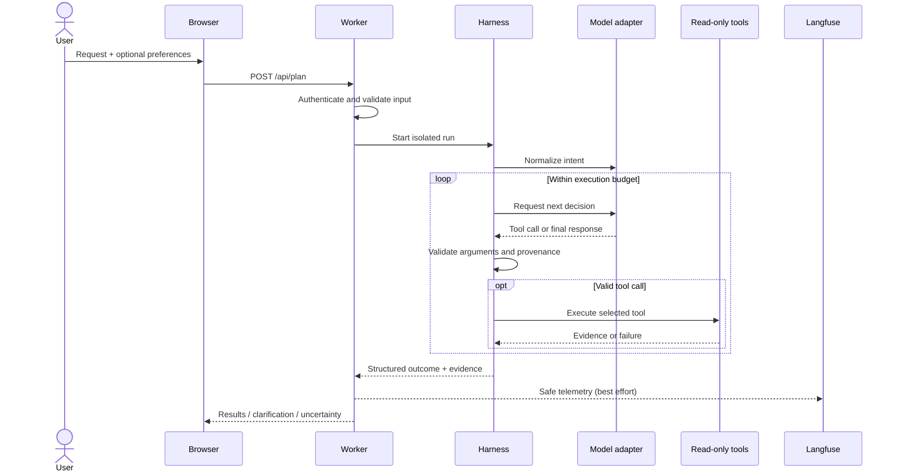

# Agent architecture

## Design decisions

- **UX-first:** capture an outdoor planning goal in free text, support optional preferences and expose results, caveats and execution evidence.
- **Model-independent harness:** the Responses API adapter proposes actions, while the harness validates and limits them. The hosted worker uses a maximum of seven steps and six tool calls; it can stop with clarification, unsupported scope or insufficient evidence.
- **Evidence over guesses:** activity web search provides sourced exploratory candidates; geocoding resolves locations separately; weather and routing evidence are obtained through read-only adapters.
- **MCP versus direct API:** the Node CLI exposes NOAA weather via an MCP server/client over stdio, sharing the HTTP adapter with the hosted Worker. The hosted runtime cannot spawn Node child processes, so it calls NOAA directly. Routing and geocoding also use direct HTTP integrations. MCP is an interface pattern, not a source of data by itself.
- **Observability:** request-scoped OpenTelemetry traces export to Langfuse via OTLP/HTTP; token usage, tool outcomes and latency support debugging. Raw prompts, responses, coordinates and visitor identity are deliberately excluded from telemetry.

## Execution flow

## Tool and data boundaries

| Integration | Implementation | Limits |
| --- | --- | --- |
| OpenAI Responses API | [Model adapter](../models/openai-model.mjs); [web discovery](../integrations/activity-search.mjs) | Schema validity and sources do not guarantee factual accuracy |
| NOAA/NWS | [Weather API](../integrations/weather-api.mjs), [MCP server](../integrations/weather-mcp-server.mjs) | Short-range point forecasts; not access or safety |
| Geocoding | [Geocoding adapter](../integrations/geocoding-api.mjs) | Representative locations can remain unresolved |
| OSRM | [Routing API](../integrations/routing-api.mjs) | Public development endpoint; estimates, not real-time traffic |
| Langfuse | [Telemetry](../integrations/langfuse-telemetry.mjs) | Best effort; not a substitute for product evaluations |

The CLI and hosted Worker share core logic, but the CLI uses fixtures and stdio MCP; the Worker adds live activity search and geocoding. The deployment bundle is generated from checked-in source in `dist/`, `models/`, `integrations/` and `worker/`.

## Guardrails and evaluation

Use [the evaluation protocol](../evals/README.md) to separate deterministic checks, controlled-tool tests, and live recommendation assessments. The historical scores are useful as baselines, not a production guarantee. Tool failures and missing evidence should be explicit. A strict transfer constraint must not be silently relaxed; exploratory leads may be displayed distinctly from supported results.
